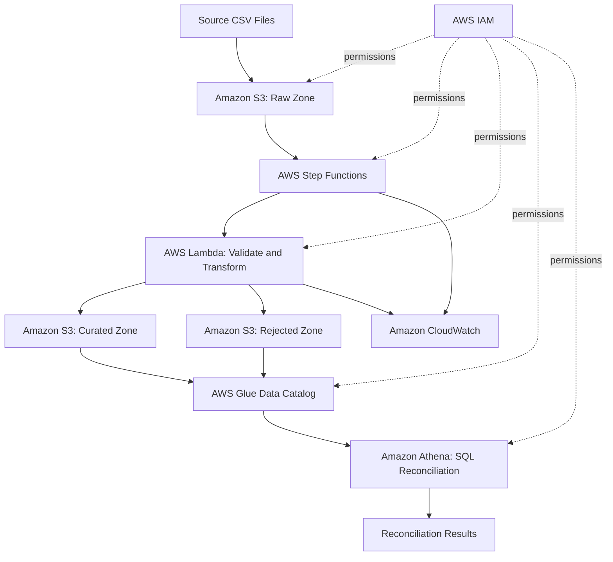

# Architecture — Cloud Data Migration & Validation Platform

## 1. Objective

Build a low-cost, serverless AWS pipeline that migrates synthetic
customer and account records from CSV files into a standardized
target data model.

## 2. Source Data

- customers.csv: 100 synthetic customer records
- accounts.csv: 150 synthetic account records
- Deliberate defects include duplicate customer IDs, missing and
  malformed emails, negative balances, invalid account types,
  missing customer references, and invalid statuses.

## 3. Target Architecture



## 4. AWS Services

- Amazon S3: raw, curated, rejected, and query-results storage
- AWS Lambda: validation, transformation, and reconciliation tasks
- AWS Step Functions: workflow orchestration and error handling
- AWS Glue Data Catalog: table and schema metadata
- Amazon Athena: SQL-based reconciliation and data-quality analysis
- Amazon CloudWatch: logs, metrics, and troubleshooting
- AWS IAM: least-privilege access control
- AWS SAM / CloudFormation: repeatable infrastructure deployment

## 5. Data Quality and Reconciliation

The pipeline will preserve source data, classify invalid records,
record rejection reasons, and reconcile source and target counts,
identifiers, balances, and record-level results.

Reconciliation discrepancies must be reported rather than silently
discarded.

## 6. Cost and Security

- Use synthetic data exclusively.
- Prefer serverless, on-demand services.
- Limit Athena scans and retain only necessary test data.
- Apply least-privilege IAM policies.
- Never commit credentials or secrets to GitHub.
- Clean up deployed resources when testing is complete.

## 7. Implementation Status

Milestone 1: Local environment, repository, synthetic source data,
and architecture documentation.

Remaining milestones will implement the processing engine,
AWS infrastructure, orchestration, SQL reconciliation, monitoring,
and end-to-end testing.
```

Save the file.

One design detail: the diagram is our **planned architecture**, not a claim that these AWS services have already been deployed. We'll implement and verify each component in later milestones.

## Step 3. Verify your project structure

Run:

```bash
find . -maxdepth 3 -type f \
  -not -path './.git/*' \
  -not -path './.venv/*' \
  | sort
```

You should see at least these files:

```text
./.gitignore
./README.md
./data/source/accounts.csv
./data/source/customers.csv
./docs/architecture.md
./src/generate_data.py
```

Your `tests` and `infrastructure` folders may not appear because they are currently empty. That's expected.

## Step 4. Commit the architecture documentation

Run:

```bash
git add docs/architecture.md
git commit -m "docs: document migration platform architecture"
git push
```

Verify the working tree:

```bash
git status
```

Ideally, you'll see:

```text
On branch main
nothing to commit, working tree clean
```

## Step 5. Final milestone checklist

{@body const items = ["Synthetic customer and account CSV files verified","All nine data-quality fixture checks passed","Architecture documented in docs/architecture.md","Changes pushed to GitHub","Git working tree clean"]}
{@body const [done, setDone] = DIL.useState([])}
<box border radius="xl" padding={3} gap={3}>
  <row align=center justify="between">
    **Milestone 1**
    <title size="lg">{done.length}/{items.length}</title>
  </row>
  {#each items as item}
    <checkbox key={item} checked={done.includes(item)} onChange={checked => setDone(old => checked ? [...old, item] : old.filter(x => x !== item))} lineThrough={false}>{item}</checkbox>
  {/each}
  <button block onClick={() => GenUI.issueNewTurn(`Milestone 1 final checklist: ${items.map(item => `${done.includes(item) ? "Complete" : "Not confirmed"}: ${item}`).join("; ")}. Help me confirm Milestone 1 completion.`)}>Confirm milestone status</button>
</box>

## Why this milestone matters for your resume

You've established a reproducible Python development environment, created a version-controlled project, generated synthetic migration data with known quality issues, and documented the intended cloud architecture.

Those are the foundations for a project that can eventually demonstrate your experience with Python, SQL, ETL, AWS serverless services, and source-to-target reconciliation.

Once you've completed the final checklist, we'll begin **Milestone 2: Build the Python validation and transformation engine**. We'll write and test that engine locally before introducing AWS, keeping the project manageable and costs low.
